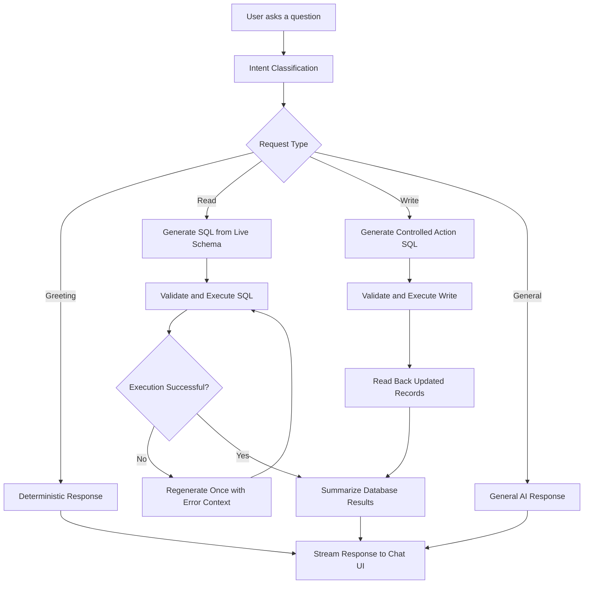

# Ask Your CRM 🤖

### An AI-Powered Conversational CRM Agent

**Ask questions about your CRM in plain English. Get answers backed by live database queries.**

Ask Your CRM transforms a traditional Customer Relationship Management (CRM) database into a conversational AI assistant. Instead of navigating dashboards, filters, and reports, users can ask questions naturally and receive clear, context-aware answers generated from real CRM data.

> **Example**
>
> **User:** Which leads haven't been contacted in the last 7 days?
>
> **AI:** Identifies the relevant leads, retrieves their details from the database, and presents a human-readable summary.

The application combines natural-language understanding, schema-aware Text-to-SQL generation, controlled SQL execution, and streamed responses in a ChatGPT-style interface.

---

## ✨ Key Features

* **Natural-Language CRM Queries** — Ask questions without writing SQL or navigating complex dashboards.
* **AI-Powered Text-to-SQL** — Generates SQL dynamically using the live database schema.
* **Live Database Insights** — Computes answers from actual CRM records rather than hardcoded responses.
* **Streaming Chat Interface** — Delivers conversational answers progressively through a clean Streamlit UI.
* **CRM Action Execution** — Supports controlled follow-up creation and record updates.
* **SQL Execution Controls** — Separates read queries from write operations and rejects prohibited SQL statements.
* **Automatic Error Recovery** — Retries SQL generation once when an execution error can be corrected.
* **Contextual Summaries** — Converts query results into readable explanations, bullet points, and key metrics.
* **Conversation Export** — Retains executed SQL and result data in message metadata for demonstration and export.
* **Deterministic Greetings** — Handles common greetings and acknowledgements without requiring an AI model call.
* **Model Fallbacks** — Supports alternative Groq-hosted models when the primary model is unavailable, subject to model and account availability.
* **Seeded Demo Dataset** — Includes sample salespeople, leads, customers, opportunities, activities, and follow-ups.

---

## 🧠 How It Works

The agent processes each request through a structured pipeline.



### Processing stages

1. **Intent classification:** Determines whether the request is a greeting, CRM read, CRM write, or general question.
2. **Schema discovery:** Reads the live SQLite schema to identify available tables and columns.
3. **SQL generation:** Creates a query or supported database action based on the user's request.
4. **Execution and validation:** Applies the application's SQL restrictions before running the operation.
5. **Error recovery:** Attempts one corrected query when a recoverable execution error occurs.
6. **Response generation:** Converts the result into a clear, conversational answer.
7. **Streaming and storage:** Displays the answer in the chat and retains relevant execution metadata.

---

## 🏗️ Technology Stack

| Component              | Technology                                                        |
| ---------------------- | ----------------------------------------------------------------- |
| Programming language   | Python                                                            |
| User interface         | Streamlit                                                         |
| AI inference           | Groq API                                                          |
| Primary language model | `llama-3.3-70b-versatile`                                         |
| Database               | SQLite                                                            |
| Query generation       | Schema-aware Text-to-SQL                                          |
| Response delivery      | Streamed chat responses                                           |
| Configuration          | Environment variables and Streamlit secrets                       |
| Deployment             | Streamlit Community Cloud, or a compatible Python hosting service |

Model availability and fallback behavior depend on the models currently supported by the provider and your API account.

---

## 📂 Project Structure

```text
ask-your-crm/
├── .streamlit/
│   └── config.toml       # Optional Streamlit configuration
├── .gitignore
├── README.md
├── requirements.txt      # Python dependencies
├── app.py                # Streamlit chat interface
├── agent.py              # AI agent and processing pipeline
├── database.py           # SQLite schema, seed data and execution
├── tools.py              # SQL tools and CRM actions
├── demo.py               # Terminal-based demonstration runner
└── demo_output.txt       # Example demonstration output
```

The application uses a modular structure to separate the UI, agent orchestration, database operations, and CRM-specific tools.

---

## 🚀 Getting Started

### Prerequisites

* Python 3.10 or a version compatible with the dependencies
* pip
* A Groq API key
* Git, if cloning the repository

### 1. Clone the repository

```bash
git clone https://github.com/nikhil-9618/ask-your-crm.git
cd ask-your-crm
```

### 2. Create a virtual environment

**Windows**

```bash
python -m venv .venv
.venv\Scripts\activate
```

**macOS / Linux**

```bash
python3 -m venv .venv
source .venv/bin/activate
```

### 3. Install dependencies

```bash
pip install -r requirements.txt
```

### 4. Configure the Groq API key

Create a `.env` file in the project root if your application loads environment variables through a library such as `python-dotenv`.

```env
GROQ_API_KEY=your_groq_api_key
GROQ_MODEL=llama-3.3-70b-versatile
```

Get an API key from the [Groq Console](https://console.groq.com/keys).

**Important:** Replace the placeholder with your actual key. Never commit a real `.env` file or API key to GitHub.

If the project does not load `.env` automatically, configure the variables through your operating system or hosting provider.

### 5. Initialize the database

```bash
python database.py
```

This command creates and seeds the sample SQLite database, according to the project's initialization logic.

To rebuild the demo dataset:

```bash
python database.py --reseed
```

**Warning:** Reseeding may replace existing demo records. Do not run it against data you need to preserve.

### 6. Launch the application

```bash
streamlit run app.py
```

Open the local URL shown in your terminal, normally:

`http://localhost:8501`

---

## 💬 Example Questions

Ask the agent questions such as:

| Category          | Example                                                       |
| ----------------- | ------------------------------------------------------------- |
| Lead management   | Which leads haven't been contacted in the last 7 days?        |
| Sales pipeline    | What is the total pipeline value in the Negotiation stage?    |
| Opportunities     | Show my top 5 opportunities by value.                         |
| Performance       | Which salesperson has the highest conversion rate this month? |
| Customer accounts | Who owns the Nova Retail account?                             |
| Follow-ups        | Which customers have pending follow-ups?                      |
| CRM actions       | Create follow-up tasks for leads not contacted in 7 days.     |
| Record updates    | Mark follow-up 3 as Done.                                     |
| General knowledge | What is the capital of France?                                |

These are examples for testing, not a fixed list of supported questions. The agent is designed to generate requests dynamically from the available schema and its supported tools. Accuracy depends on the database contents, model output, and execution safeguards.

---

## 🧪 Testing and Demonstration

Run the terminal demonstration:

```bash
python demo.py
```

Run the action demonstration:

```bash
python demo.py --actions
```

Run all supported demonstration checks:

```bash
python demo.py --all
```

**Note:** Action demonstrations can modify the SQLite database. Use the seeded demo dataset and review the action logic before running them.

### Suggested validation checklist

* [ ] Greetings return deterministic responses.
* [ ] Read queries retrieve results from the live database.
* [ ] SQL execution errors trigger no more than one regeneration attempt.
* [ ] Invalid or prohibited SQL statements are rejected.
* [ ] Follow-up creation avoids duplicates under the application's defined rules.
* [ ] Updates return confirmation based on the resulting database record.
* [ ] Conversation answers stream correctly in the UI.
* [ ] Exported message metadata includes the expected SQL and result information.
* [ ] Missing or invalid API keys produce a useful error message.

---

## 🔐 Security and Reliability

Ask Your CRM includes application-level controls intended to reduce unsafe database operations.

* **Restricted read queries:** Read operations are intended to allow `SELECT` statements only.
* **Restricted write operations:** Write operations are intended to allow supported data-modification statements.
* **Statement validation:** Multiple SQL statements and prohibited schema-changing operations are rejected.
* **Bounded retry:** Failed query generation is retried once rather than indefinitely.
* **Write confirmation:** Updated records can be retrieved to confirm the result of an action.
* **Secret management:** API credentials should be stored in environment variables or hosting-provider secrets.

### Production considerations

These controls should not be treated as a complete security boundary. Before using real customer data:

1. Validate SQL with a robust parser and enforce table-, column-, and operation-level permissions.
2. Use parameterized queries for values wherever possible.
3. Restrict write actions to explicitly authorized operations and validate user intent.
4. Apply authentication, authorization, rate limiting, and appropriate audit logging.
5. Avoid exposing sensitive query results, database errors, credentials, or customer information.
6. Back up persistent data and test recovery procedures.
7. Use synthetic data for demonstrations and development.

An AI-generated query must never be trusted solely because it was produced by the model.

---

## ☁️ Deployment

### Option 1: Streamlit Community Cloud

Recommended for a straightforward Streamlit deployment.

1. Push the project to GitHub.
2. Open [Streamlit Community Cloud](https://share.streamlit.io/).
3. Create a new app and select this repository.
4. Set the main file path to `app.py`.
5. Add the following secret in the app's settings:

```toml
GROQ_API_KEY = "your_groq_api_key"
GROQ_MODEL = "llama-3.3-70b-versatile"
```

6. Deploy the application and check the logs if startup fails.

The app will receive a hosted URL under the `streamlit.app` domain.

### Option 2: Render

For a Python-based Render service, use these settings:

| Setting        | Value                                                               |
| -------------- | ------------------------------------------------------------------- |
| Runtime        | Python                                                              |
| Root Directory | Blank, if the files are in the repository root                      |
| Build Command  | `pip install -r requirements.txt`                                   |
| Start Command  | `streamlit run app.py --server.port $PORT --server.address 0.0.0.0` |

Add `GROQ_API_KEY` under the service's environment variables.

**Persistence warning:** A SQLite database stored on an ephemeral filesystem may be reset or lost during redeploys or instance replacement. Use persistent storage or a managed database if records must survive restarts. Confirm the host's current free-tier limits before relying on continuous availability.

---

## ⚙️ Configuration Reference

| Variable       | Purpose                                |
| -------------- | -------------------------------------- |
| `GROQ_API_KEY` | Authenticates requests to the Groq API |
| `GROQ_MODEL`   | Optional primary model override        |

The application may support additional configuration. Check the source code for the exact variables it reads.

---

## 🗺️ Roadmap

Potential future enhancements include:

* Multi-user authentication and role-based access control
* Support for additional SQL databases
* CRM integrations with external platforms
* More detailed audit trails and action approval workflows
* Persistent conversation history
* Dashboard visualizations and downloadable reports
* Automated evaluation of generated SQL and answer accuracy
* Read-only mode and configurable write permissions

---

## 🤝 Contributing

Contributions, bug reports, and improvement suggestions are welcome.

1. Fork the repository.
2. Create a feature branch.
3. Make and test your changes.
4. Submit a pull request with a clear description.

For security issues, avoid publishing credentials, customer data, or exploitable details in public issues.

---

## 📄 License

This project is licensed under the **MIT License**.

You are free to use, copy, modify, merge, publish, distribute, sublicense, and sell copies of this software, subject to the terms of the license.

See the [`LICENSE`](LICENSE) file for the full license text.

---

## 👨‍💻 Project

**Ask Your CRM — AI-Powered Conversational CRM Agent**

Built with Python, Streamlit, SQLite, and Groq.

[View the GitHub Repository](https://github.com/nikhil-9618/ask-your-crm) · [Get a Groq API Key](https://console.groq.com/keys) · [Deploy with Streamlit](https://share.streamlit.io/)

*Turn CRM data into answers you can ask for.*
